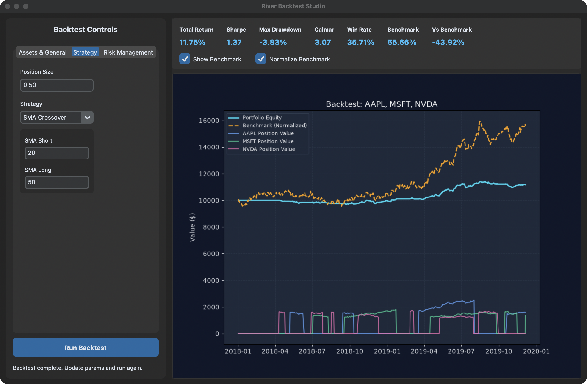
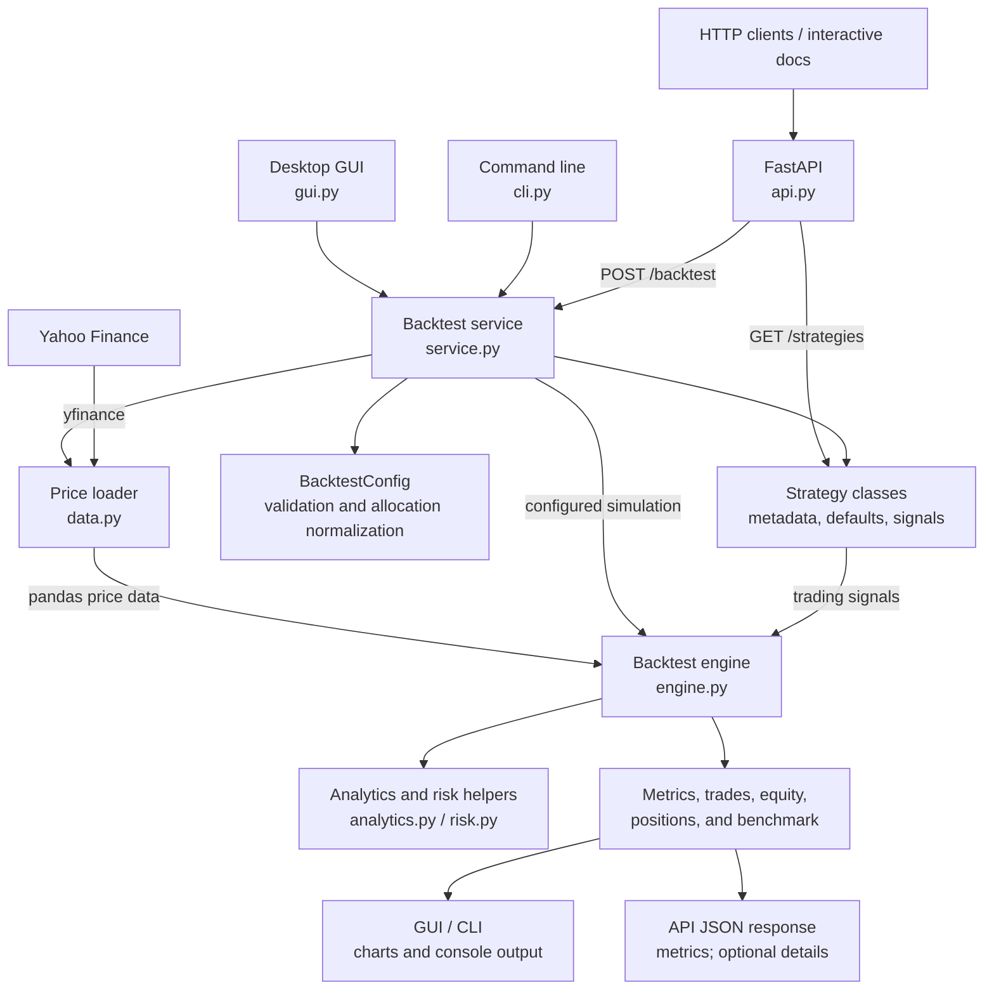

# River Backtest Studio

Test SMA crossover and RSI reversion strategies across a portfolio of tickers through a desktop GUI, CLI, or FastAPI REST API. The multithreaded Python engine models next-bar execution, commissions, slippage, and configurable risk controls. Compare portfolio performance with a weighted buy-and-hold benchmark using desktop charts or JSON results.



*Example run on synthetic daily prices. The dashed line shows what the same starting allocations would have earned under buy-and-hold.*

## Setup

From the project directory, create a virtual environment with Python 3.10 or newer and Tk support.

```sh
python -m venv .venv
source .venv/bin/activate
python -m pip install -e .
river-backtest-gui
```

On Windows PowerShell, activate the environment with `.\.venv\Scripts\Activate.ps1`. Running a backtest from the app requires an internet connection to download adjusted daily prices from Yahoo Finance. After installation, `python gui_app.py` remains available as a launcher from the project directory.

## Run a backtest

1. Open **Assets & General**. Enter tickers, allocation weights, a start date, and starting capital. The app scales the weights to sum to one. Commission is a flat fee per trade, and slippage is a fraction of the execution price.
2. Open **Strategy**. Select **SMA Crossover** to trade crossings of the short and long moving averages, or **RSI Reversion** to buy at the oversold threshold and sell at the overbought threshold.
3. Open **Risk Management** to set a stop loss, take profit, or portfolio drawdown cutoff. For example, a stop loss of `0.25` represents 25%. Rolling Kelly adjusts position size using completed trades.
4. Select **Run Backtest**. Use **Show Benchmark** to overlay buy-and-hold equity and **Normalize Benchmark** to align its starting value with the portfolio.


*The same example run with the Assets & General tab open. The solid position-value lines show each ticker’s exposure over time.*

## Command-line usage

Edit [src/river_backtest/config.py](src/river_backtest/config.py) to set the portfolio, trading costs, strategy, and risk controls. Then run the configured backtest and open its chart:

```sh
river-backtest
```

The default CLI configuration starts on January 1, 2018 with $10,000 allocated across AAPL (34%), MSFT (33%), and NVDA (33%). All three interfaces use `BacktestConfig`. `GUI_CONFIG` explicitly disables the default 20% drawdown cutoff to preserve the desktop app's previous default. Set `strategy` to `"SMA Crossover"` or `"RSI Reversion"`; supply overrides through `strategy_parameters`, such as `{"short_window": 20, "long_window": 50}` for SMA or `{"period": 14, "oversold": 30, "overbought": 70}` for RSI. Omitted parameters use the defaults declared by the selected strategy. After installation, `python run_backtest.py` also works from the project directory.

## API usage

With the project installed and the virtual environment activated, install the API server and launch it from the project root:

```sh
python -m pip install uvicorn
python api_app.py
```

The development server listens on `http://127.0.0.1:8000` and reloads when source files change. Open the [interactive API docs](http://127.0.0.1:8000/docs) to submit requests: expand an endpoint, select **Try it out**, and then **Execute**.

| Method | Endpoint | Purpose |
| --- | --- | --- |
| `GET` | `/health` | Return `{"status": "ok"}` without downloading prices. |
| `GET` | `/strategies` | Discover strategy classes and return their names, descriptions, and default parameters. |
| `POST` | `/backtest` | Run a backtest with a JSON configuration and return performance metrics. |
| `POST` | `/backtest?include_details=true` | Also return trades, portfolio equity, per-ticker position values, and the benchmark curve. |

For example, submit an SMA backtest from a terminal:

```sh
curl -X POST 'http://127.0.0.1:8000/backtest' \
  -H 'Content-Type: application/json' \
  -d '{
    "tickers": ["AAPL", "MSFT"],
    "allocations": {"AAPL": 0.6, "MSFT": 0.4},
    "start_date": "2025-01-01",
    "initial_capital": 10000,
    "strategy": "SMA Crossover",
    "strategy_parameters": {"short_window": 10, "long_window": 50},
    "commission": 2,
    "slippage": 0.0001
  }'
```

Use the same request body with `?include_details=true` to retrieve chart and trade data. The request waits for the price download and simulation to finish; it does not create a saved run or background job. Entering `/backtest` in a browser address bar sends a GET request, so use the interactive docs or a client that supports POST.

- **Defaults and overrides.** General settings use the defaults in `config.py`; strategy parameters override the selected strategy's defaults. API requests that omit `allocations` use equal weights across the submitted tickers. Supplied weights are normalized to sum to one.
- **Risk controls.** Requests also accept position sizing, static and rolling Kelly settings, stop loss, take profit, and drawdown cutoff fields. See `/docs` for the full request schema. Percentage settings use fractions, such as `0.25` for 25%; nullable risk exits can be disabled with `null`.
- **Validation.** Invalid settings, unknown fields, and invalid strategy parameters return HTTP `422` before downloading prices. Use JSON numbers and booleans rather than quoted strings. Price-download and execution failures currently use the server's default error handling.
- **Results.** The default response contains a `metrics` object. Detailed responses add `trades`, `equity_curve`, `ticker_value_curve`, and `benchmark_curve` arrays. Dates are ISO strings and missing numeric results serialize as `null`.
- **Strategy discovery.** `/strategies` reads metadata from concrete classes in `strategies/`. Adding a class makes it discoverable, but execution still requires updating the supported strategies in `config.py` and `service.py`; the GUI also has strategy-specific controls.

## Architecture

The GUI, CLI, and API share configuration validation and backtest execution. The engine accepts in-memory pandas price data, so simulations can also run offline without the download layer.



## Project layout

Application code lives in `src/river_backtest/`:

- `engine.py`: portfolio simulation and trade accounting; accepts in-memory pandas data without downloading prices or importing plotting code.
- `analytics.py` and `risk.py`: benchmarks, performance metrics, and Kelly sizing.
- `config.py`: shared defaults, portfolio normalization, and settings validation.
- `data.py`: adjusted daily price downloads from Yahoo Finance.
- `service.py`: validates configuration, constructs a strategy, loads prices, and runs the engine.
- `strategies/`: the strategy interface, metadata, parameter defaults, SMA crossover, and RSI reversion.
- `api.py`: FastAPI routes, request validation, strategy discovery, and JSON serialization.
- `gui.py`, `cli.py`, and `reporting.py`: desktop controls, command-line entry point, and charts/console output.

`tests/` contains offline regression tests. README screenshots live in `docs/images/`. `gui_app.py`, `run_backtest.py`, and `api_app.py` launch the desktop app, CLI, and API server respectively; application imports use the `river_backtest` package.

## How the engine works

- **Execution.** A signal generated at a ticker’s close can execute at its next available open. Trades use the portfolio’s shared cash balance and execute in ticker order.
- **Concurrency.** Up to four workers fetch ticker histories, and up to four prepare per-ticker strategy signals. A separate thread computes buy-and-hold equity while the portfolio simulation runs.
- **Desktop execution.** The GUI snapshots and validates settings before starting a worker. Results and errors return through a queue, with all widget access on the UI thread.
- **Results.** The engine returns the trade log, portfolio equity, per-ticker position values, benchmark curve, and metrics including total return, Sharpe ratio, maximum drawdown, win rate, and benchmark outperformance.
