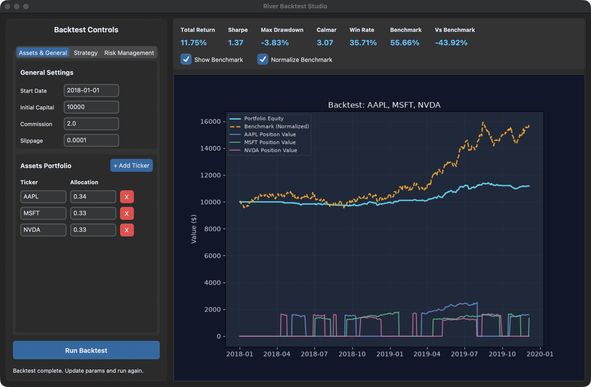

# River Backtest Studio

Test SMA crossover and RSI reversion strategies across a portfolio of tickers. The Python engine models next-bar execution, commissions, and slippage, and the desktop app plots portfolio equity alongside a weighted buy-and-hold benchmark.


*Example run on synthetic daily prices. The dashed line shows what the same starting allocations would have earned under buy-and-hold.*

## Setup

From the project directory, create a virtual environment with Python 3.10 or newer and Tk support.

```sh
python -m venv .venv
source .venv/bin/activate
python -m pip install -e .
river-backtest-gui
```

On Windows PowerShell, activate the environment with `.\.venv\Scripts\Activate.ps1`. Running a backtest from the app requires an internet connection to download adjusted daily prices from Yahoo Finance. After installation, `python gui_app.py` remains available as a launcher from the project directory.

## Run a backtest

1. Open **Assets & General**. Enter tickers, allocation weights, a start date, and starting capital. The app scales the weights to sum to one. Commission is a flat fee per trade, and slippage is a fraction of the execution price.
2. Open **Strategy**. Select **SMA Crossover** to trade crossings of the short and long moving averages, or **RSI Reversion** to buy at the oversold threshold and sell at the overbought threshold.
3. Open **Risk Management** to set a stop loss, take profit, or portfolio drawdown cutoff. For example, a stop loss of `0.25` represents 25%. Rolling Kelly adjusts position size using completed trades.
4. Select **Run Backtest**. Use **Show Benchmark** to overlay buy-and-hold equity and **Normalize Benchmark** to align its starting value with the portfolio.



*The same example run with the Assets & General tab open. The solid position-value lines show each ticker’s exposure over time.*

## Command-line usage

Edit [src/river_backtest/config.py](src/river_backtest/config.py) to set the portfolio, trading costs, strategy, and risk controls. Then run the configured backtest and open its chart:

```sh
river-backtest
```

The default CLI configuration starts on January 1, 2018 with $10,000 allocated across AAPL (34%), MSFT (33%), and NVDA (33%). Both interfaces use `BacktestConfig`. `GUI_CONFIG` explicitly disables the default 20% drawdown cutoff to preserve the desktop app's previous default. Set `strategy` to `"SMA Crossover"` or `"RSI Reversion"`; the relevant parameters live in the same configuration. After installation, `python run_backtest.py` also works from the project directory.

## Project layout

Application code lives in `src/river_backtest/`:

- `engine.py`: portfolio simulation and trade accounting; accepts in-memory pandas data without downloading prices or importing plotting code.
- `analytics.py` and `risk.py`: benchmarks, performance metrics, and Kelly sizing.
- `config.py`: shared defaults, portfolio normalization, and settings validation.
- `data.py`: adjusted daily price downloads from Yahoo Finance.
- `service.py`: validates configuration, constructs a strategy, loads prices, and runs the engine.
- `strategies/`: the strategy interface, SMA crossover, and RSI reversion.
- `gui.py`, `cli.py`, and `reporting.py`: desktop controls, command-line entry point, and charts/console output.

`tests/` contains offline regression tests. README screenshots live in `docs/images/`. The root-level Python scripts are compatibility launchers; application imports use the `river_backtest` package.

## Development

Install the package and formatter in the virtual environment, then run the offline checks:

```sh
python -m pip install -e ".[dev]"
python -m unittest discover -s tests -v
ruff check .
ruff format --check .
```

Use `ruff format .` to apply the project's formatting. Tests use synthetic prices and mocked downloads, so they do not require Yahoo Finance access or a desktop display.

## How the engine works

- **Execution.** A signal generated at a ticker’s close can execute at its next available open. Trades use the portfolio’s shared cash balance and execute in ticker order.
- **Concurrency.** Up to four workers fetch ticker histories, and up to four prepare per-ticker strategy signals. A separate thread computes buy-and-hold equity while the portfolio simulation runs.
- **Desktop execution.** The GUI snapshots and validates settings before starting a worker. Results and errors return through a queue, with all widget access on the UI thread.
- **Results.** The engine returns the trade log, portfolio equity, per-ticker position values, benchmark curve, and metrics including total return, Sharpe ratio, maximum drawdown, win rate, and benchmark outperformance.
