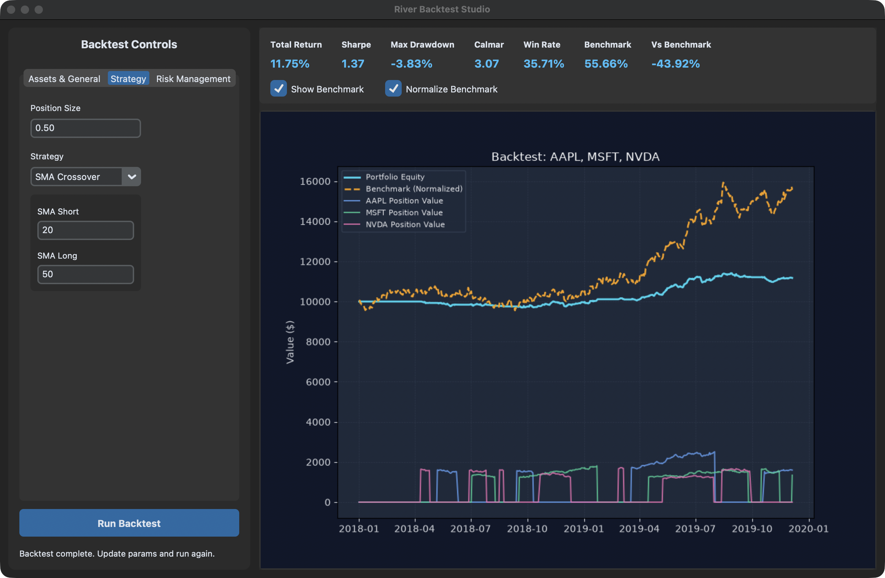
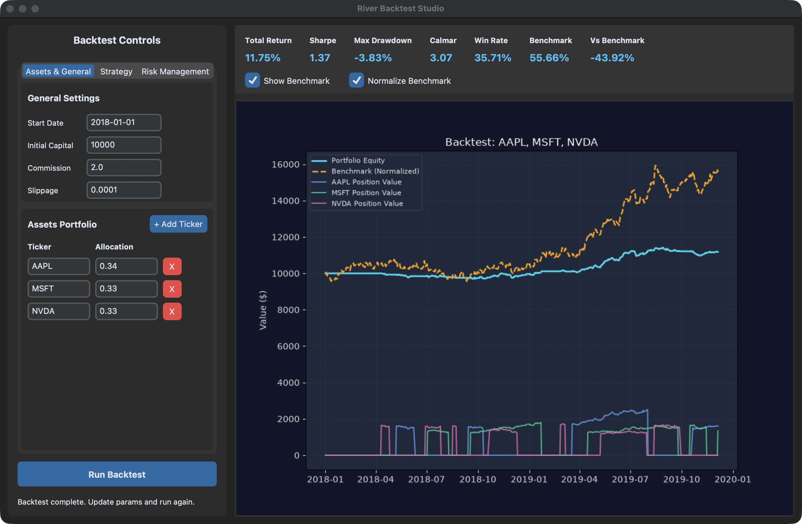

# River Backtest Studio

Test SMA crossover and RSI reversion strategies across a portfolio of tickers. The Python engine models next-bar execution, commissions, and slippage, and the desktop app plots portfolio equity alongside a weighted buy-and-hold benchmark.



*Example run on synthetic daily prices. The dashed line shows what the same starting allocations would have earned under buy-and-hold.*

## Setup

From the project directory, create a virtual environment with Python 3.10 or newer and Tk support.

```sh
python -m venv .venv
source .venv/bin/activate
python -m pip install pandas numpy matplotlib customtkinter yfinance
python gui_app.py
```

On Windows PowerShell, activate the environment with `.\.venv\Scripts\Activate.ps1`. Running a backtest from the app requires an internet connection to download adjusted daily prices from Yahoo Finance.

## Run a backtest

1. Open **Assets & General**. Enter tickers, allocation weights, a start date, and starting capital. The app scales the weights to sum to one. Commission is a flat fee per trade, and slippage is a fraction of the execution price.
2. Open **Strategy**. Select **SMA Crossover** to trade crossings of the short and long moving averages, or **RSI Reversion** to buy at the oversold threshold and sell at the overbought threshold.
3. Open **Risk Management** to set a stop loss, take profit, or portfolio drawdown cutoff. For example, a stop loss of `0.25` represents 25%. Rolling Kelly adjusts position size using completed trades.
4. Select **Run Backtest**. Use **Show Benchmark** to overlay buy-and-hold equity and **Normalize Benchmark** to align its starting value with the portfolio.



*The same example run with the Assets & General tab open. The solid position-value lines show each ticker’s exposure over time.*

## Command-line usage

Edit [config.py](config.py) to set the portfolio, trading costs, SMA windows, and risk controls. Then run the SMA backtest and open its chart:

```sh
python run_backtest.py
```

The default CLI configuration starts on January 1, 2018 with $10,000 allocated across AAPL (34%), MSFT (33%), and NVDA (33%). The GUI has its own editable defaults.

## How the engine works

- **Execution.** A signal generated at a ticker’s close can execute at its next available open. Trades use the portfolio’s shared cash balance and execute in ticker order.
- **Concurrency.** Up to four workers fetch ticker histories, and up to four prepare per-ticker strategy signals. A separate thread computes buy-and-hold equity while the portfolio simulation runs.
- **Results.** The engine returns the trade log, portfolio equity, per-ticker position values, benchmark curve, and metrics including total return, Sharpe ratio, maximum drawdown, win rate, and benchmark outperformance.
